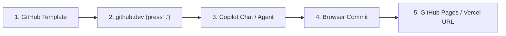
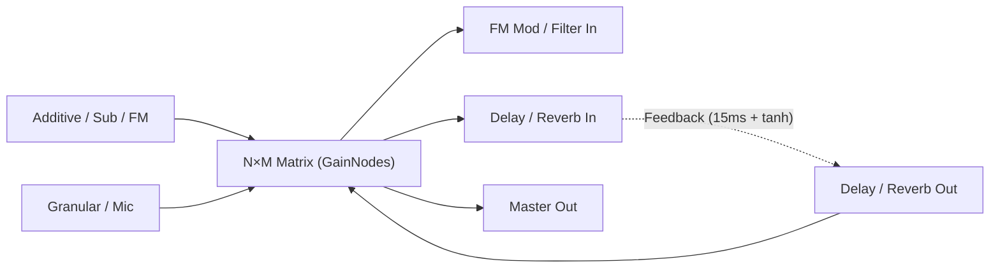

|  |                |                        |
| ---------------------------------------- |:-------------- | ----------------------:|
| **class 03**                             | Oct 16th, 2026 | *internet et agentic music 26/27* |

# Photo-Console & Audio Matrix

Turning any photograph into a modular synthesizer and feedback matrix with [[webaudioapi]]

Course: Internet and Agentic Music (HEM)

note: The entire session runs in the browser with zero local installation. Open index.html or edit directly inside github.dev (press the '.' key on GitHub) with Copilot.

---

## 100% Cloud Workflow — Zero Local Installation



- Zero local Python, Node.js, or Git installation on student computers
- Browser IDE: pressing `.` on any GitHub repository opens **VS Code for the Web** (`github.dev`)
- **GitHub Education**: free [[copilot]] Pro & **GitHub Codespaces** for verified students/teachers
- Whenever Python is needed (heavy audio AI models): **Google [[colab]]** only

note: Remind students to add their @hesge.ch email to their existing GitHub account and apply at education.github.com. Meanwhile, Copilot Free works immediately.

---

## Project Goal

1. Pick any **photograph** (mixing desk, synth panel, street object, score, painting)
2. Crop two interactive control shapes directly out of the image on an HTML5 [[canvas]]:
   - **Circular Rotary Knob**: spins around its own center (`ctx.rotate`)
   - **Polygonal / Rectangular Slider + Vector Arrow**: slides along a drawn direction arrow
3. Build core [[webaudioapi]] modules: **Additive, Subtractive, FM, Granular, Mic In, Delay, Reverb**
4. Route everything through an **$N \times M$ [[multiplexer]] audio matrix** to create controllable [[feedback]] loops

---

## The 12 Project Steps (Obsidian Index)

| # | Step Note | Key Concepts `[[ ]]` |
|---|---|---|
| 1 | `[[01-image-loader]]` | `[[html]]`, `[[variable]]`, `[[event-listener]]` |
| 2 | `[[02-circular-knob-crop]]` | `[[canvas]]`, `[[function]]`, `[[parameter]]` |
| 3 | `[[03-polygon-slider-crop]]` | `[[array]]`, `[[object]]`, `[[arrow-function]]`, `[[normalization]]` |
| 4 | `[[04-audio-context-init]]` | `[[webaudioapi]]`, `[[AudioContext]]`, `[[GainNode]]` |
| 5 | `[[05-additive-synth]]` | `[[additive-synthesis]]`, `[[loop]]`, `[[OscillatorNode]]` |
| 6 | `[[06-subtractive-synth]]` | `[[subtractive-synthesis]]`, `[[BiquadFilterNode]]` |
| 7 | `[[07-fm-synth]]` | `[[fm-synthesis]]`, `[[AudioParam]]` |
| 8 | `[[08-granular-engine]]` | `[[granular-synthesis]]`, `[[AudioBuffer]]`, `[[callback]]` |
| 9 | `[[09-mic-delay-reverb]]` | `[[getUserMedia]]`, `[[DelayNode]]`, `[[ConvolverNode]]` |
| 10 | `[[10-audio-matrix-multiplexer]]` | `[[multiplexer]]`, `[[2d-array]]`, `[[feedback]]` |
| 11 | `[[11-control-mapping]]` | `[[mapping]]`, `[[JSON]]` |
| 12 | `[[12-cloud-deploy]]` | `[[github-dev]]`, `[[github-pages]]`, `[[vercel]]` |

---

## Step 1. Loading the Image (`[[01-image-loader]]`)

Store the image in a [[variable]] and paint it onto a `<canvas>`:

```javascript
const canvas = document.getElementById("consoleCanvas");
const g = canvas.getContext("2d");

imgInput.addEventListener("change", (e) => {
  const file = e.target.files[0]; // local [[variable]]
  // FileReader loads the image in memory with no server
});
```

- `const` declares a [[variable]] whose reference stays constant
- `addEventListener` registers an [[event-listener]] waiting for user action
- `(e) => { ... }` is an [[arrow-function]] executed when the file is chosen

---

## Step 2. Circular Image Crop — Rotary Knob (`[[02-circular-knob-crop]]`)

Cut a circle `(cx, cy, r)` from the photograph and spin it by angle $\theta$:

```javascript
function drawKnob(ctrl) {
  const angle = (ctrl.val - 0.5) * Math.PI * 1.65;
  g.save();
  g.beginPath();
  g.arc(ctrl.cx, ctrl.cy, ctrl.r, 0, Math.PI * 2);
  g.clip();                        // circular clipping mask
  g.translate(ctrl.cx, ctrl.cy);   // move origin to knob center
  g.rotate(angle);                 // rotate around its own center
  g.drawImage(basePhoto, -ctrl.cx, -ctrl.cy);
  g.restore();
}
```

- Concepts: [[function]], [[parameter]] (`ctrl`), [[canvas]] `clip()`
- **Agent prompt**: *"Explain how `g.translate` and `g.rotate` spin only the circular cutout without rotating the rest of the photograph."*

---

## Step 3. Polygon Crop + Displacement Vector (`[[03-polygon-slider-crop]]`)

A slider is defined by an [[array]] of corner points `poly` and a direction vector $\vec{v} = (vx_1 - vx_0, vy_1 - vy_0)$:

```javascript
const poly = [{x: 206, y: 347}, {x: 254, y: 347}, {x: 254, y: 383}, {x: 206, y: 383}];

const projectOnArrow = (pt, ctrl) => {
  const vx = ctrl.vx1 - ctrl.vx0, vy = ctrl.vy1 - ctrl.vy0;
  const t = ((pt.x - ctrl.vx0) * vx + (pt.y - ctrl.vy0) * vy) / (vx*vx + vy*vy);
  return Math.max(0, Math.min(1, t)); // [[normalization]] to 0.0 .. 1.0
};
```

- Each corner is an [[object]] `{x, y}` stored inside an [[array]] `[...]`
- The dot product projects mouse dragging onto the arrow vector and normalizes it to $[0, 1]$

---

## Step 4. Starting the Audio Graph (`[[04-audio-context-init]]`)

```javascript
const ctx = new AudioContext();
const masterGain = ctx.createGain();
const limiter = ctx.createDynamicsCompressor();
masterGain.connect(limiter).connect(ctx.destination);
```

- [[AudioContext]] is the browser's real-time audio engine ([[webaudioapi]])
- Every module is an [[AudioNode]] wired via `.connect()`
- The compressor/limiter protects ears during [[feedback]] experiments

---

## Steps 5 & 6. Additive & Subtractive Synthesis

**[[additive-synthesis]]**: summing harmonic partials with a `for` [[loop]]:

```javascript
for (let h = 1; h <= 6; h++) {
  const osc = ctx.createOscillator(); // [[OscillatorNode]]
  osc.frequency.value = baseFreq * h; // harmonic h * f0
}
```

**[[subtractive-synthesis]]**: filtering a harmonic-rich wave (`sawtooth`) with a [[BiquadFilterNode]]:

```javascript
subOsc.type = "sawtooth";
subFilter.type = "lowpass";
subFilter.frequency.value = 950; // cutoff frequency (Hz)
subFilter.Q.value = 4.5;         // resonance (Q)
```

---

## Steps 7 & 8. FM & Granular Synthesis

**[[fm-synthesis]]**: a *modulator* oscillator modulates the *carrier* frequency at audio rate:

```javascript
fmMod.connect(fmIndexGain).connect(fmCarrier.frequency);
```

**[[granular-synthesis]]**: scheduling clouds of micro-grains (20–300 ms) from an [[AudioBuffer]]:

```javascript
const src = ctx.createBufferSource();
src.buffer = granBuffer;
src.start(now, offset, grainDuration);
```

---

## Step 9. Microphone, Delay & Reverb (`[[09-mic-delay-reverb]]`)

- **Microphone**: `navigator.mediaDevices.getUserMedia({ audio: true })`
- **Delay**: [[DelayNode]] (`ctx.createDelay(2.0)`) + low-pass damping filter
- **Reverb**: [[ConvolverNode]] with a synthetic stereo impulse response computed in JS (zero external files)

```javascript
data[i] = (Math.random() * 2 - 1) * Math.pow(1 - i / len, decay);
```

---

## Step 10. The $N \times M$ Audio Matrix (Multiplexer) & Feedback



- A 2D grid ([[2d-array]]) where each intersection $(i, j)$ is an independent `[[GainNode]]`
- **Soft-clipping ($\tanh$)**: a `WaveShaperNode` prevents runaway digital distortion in [[feedback]] loops:

$$\text{out} = \tanh(2.2 \cdot x)$$

---

## Steps 11 & 12. Control Mapping & Cloud Deployment

- Every knob or slider cropped from the photo maps to a key in the `PARAMS` [[object]]:
  - either a synthesis parameter (`fm.index`, `sub.cutoff`, `gran.pos`)
  - or any matrix crosspoint (`mat.del.fmMod`, `mat.rev.delIn`)
- Export/Import full patches as [[JSON]]
- **Publish**: Commit from `github.dev` → live HTTPS URL on [[github-pages]] or [[vercel]]

---

## Workshop Protocol with the Coding Agent (30 min)

1. Open `03_photo_console_webaudio_matrix/index.html` in the browser
2. Crop **3 circular Knobs** and **2 polygonal Sliders with arrows** on your chosen photo
3. Map at least one photo control to a **matrix feedback crosspoint** (red cells)
4. Copy one of the 4 didactic prompts into the agent chat (`github.dev` Copilot or web chat)
5. Complete 2 glossary notes in `glossaire/` (e.g. [[variable]], [[arrow-function]], [[multiplexer]], [[feedback]])

---

## References

```bibtex
@book{roads2001microsound, author={Roads, Curtis}, title={Microsound}, publisher={MIT Press}, year={2001}}
@article{chowning1973fm, author={Chowning, John M.}, title={The Synthesis of Complex Audio Spectra by Means of Frequency Modulation}, journal={Journal of the Audio Engineering Society}, year={1973}, volume={21}, number={7}, pages={526--534}}
@misc{mdnwebaudio, author={{MDN Contributors}}, title={Web Audio API}, howpublished={https://developer.mozilla.org/en-US/docs/Web/API/Web_Audio_API}, year={2026}}
```
