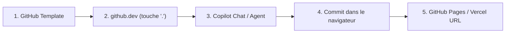
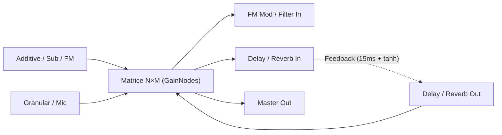

|  |                |                        |
| ---------------------------------------- |:-------------- | ----------------------:|
| **class 03**                             | Oct 16th, 2026 | *internet et agentic music 26/27* |

# Photo-Console & Matrice Audio

Transformer une photographie en synthétiseur modulaire et matrice de feedback avec [[webaudioapi]]

Cours : Internet et musique agentique (HEM)

note: Toute la séance fonctionne dans le navigateur (zéro installation locale). Ouvrir index.html ou éditer directement dans github.dev (touche point '.') avec Copilot.

---

## Circuit 100 % Cloud — Zéro Installation



- Aucun Python, Node ni Git local à installer sur les machines des étudiants
- Éditeur en ligne : appuyer sur `.` dans un dépôt GitHub ouvre **VS Code Web** (`github.dev`)
- **GitHub Education** : [[copilot]] gratuit pour les étudiants + **GitHub Codespaces**
- Si Python est nécessaire (modèles IA lourds) : **Google [[colab]]** uniquement

note: Rappeler aux étudiants de rattacher leur adresse @hesge.ch à leur compte GitHub existant sur education.github.com. En attendant la validation, Copilot Free est déjà actif.

---

## Objectif du projet

1. Choisir une **photographie** (console analogique, objet, peinture, façade)
2. Découper deux types de contrôles directement dans l'image sur un [[canvas]] :
   - **Cercle rotatif (Knob)** : tourne sur lui-même (`ctx.rotate`)
   - **Polygone / rectangle + flèche vectorielle (Slider)** : glisse le long de la flèche
3. Générer les modules [[webaudioapi]] : **Additif, Soustractif, FM, Granulaire, Mic, Delay, Reverb**
4. Tout interconnecter dans une **matrice [[multiplexer]] $N \times M$** avec boucles de [[feedback]]

---

## Les 12 étapes du projet (Index Obsidian)

| # | Étape | Concepts clés `[[ ]]` |
|---|---|---|
| 1 | `[[01-image-loader]]` | `[[html]]`, `[[variable]]`, `[[event-listener]]` |
| 2 | `[[02-circular-knob-crop]]` | `[[canvas]]`, `[[function]]`, `[[parameter]]` |
| 3 | `[[03-polygon-slider-crop]]` | `[[array]]`, `[[object]]`, `[[arrow-function]]`, `[[normalization]]` |
| 4 | `[[04-audio-context-init]]` | `[[webaudioapi]]`, `[[AudioContext]]`, `[[GainNode]]` |
| 5 | `[[05-additive-synth]]` | `[[additive-synthesis]]`, `[[loop]]`, `[[OscillatorNode]]` |
| 6 | `[[06-subtractive-synth]]` | `[[subtractive-synthesis]]`, `[[BiquadFilterNode]]` |
| 7 | `[[07-fm-synth]]` | `[[fm-synthesis]]`, `[[AudioParam]]` |
| 8 | `[[08-granular-engine]]` | `[[granular-synthesis]]`, `[[AudioBuffer]]`, `[[callback]]` |
| 9 | `[[09-mic-delay-reverb]]` | `[[getUserMedia]]`, `[[DelayNode]]`, `[[ConvolverNode]]` |
| 10 | `[[10-audio-matrix-multiplexer]]` | `[[multiplexer]]`, `[[2d-array]]`, `[[feedback]]` |
| 11 | `[[11-control-mapping]]` | `[[mapping]]`, `[[JSON]]` |
| 12 | `[[12-cloud-deploy]]` | `[[github-dev]]`, `[[github-pages]]`, `[[vercel]]` |

---

## Étape 1. Charger l'image (`[[01-image-loader]]`)

Stocker la photo dans une [[variable]] et la dessiner sur un `<canvas>` :

```javascript
const canvas = document.getElementById("consoleCanvas");
const g = canvas.getContext("2d");

imgInput.addEventListener("change", (e) => {
  const file = e.target.files[0]; // [[variable]] locale
  // FileReader charge l'image sans serveur
});
```

- `const` déclare une [[variable]] dont la référence ne change pas
- `addEventListener` crée un [[event-listener]] qui attend un geste humain
- Une fonction fléchée `(e) => { ... }` ([[arrow-function]]) réagit à l'événement

---

## Étape 2. Découpe circulaire — Le Knob (`[[02-circular-knob-crop]]`)

On découpe un cercle `(cx, cy, r)` dans la photo et on le fait tourner d'un angle $\theta$ :

```javascript
function drawKnob(ctrl) {
  const angle = (ctrl.val - 0.5) * Math.PI * 1.65;
  g.save();
  g.beginPath();
  g.arc(ctrl.cx, ctrl.cy, ctrl.r, 0, Math.PI * 2);
  g.clip();                        // masque circulaire
  g.translate(ctrl.cx, ctrl.cy);   // origine au centre du bouton
  g.rotate(angle);                 // rotation sur lui-même
  g.drawImage(basePhoto, -ctrl.cx, -ctrl.cy);
  g.restore();
}
```

- Notions : [[function]], [[parameter]] (`ctrl`), masque [[canvas]] `clip()`
- **Prompt à l'agent** : *« Explique comment `g.translate` et `g.rotate` permettent de tourner uniquement le cercle découpé sans tourner toute la photo. »*

---

## Étape 3. Polygone + Flèche de déplacement (`[[03-polygon-slider-crop]]`)

Un fader est défini par un [[array]] de points `poly` et un vecteur fléché $\vec{v} = (vx_1 - vx_0, vy_1 - vy_0)$ :

```javascript
const poly = [{x: 206, y: 347}, {x: 254, y: 347}, {x: 254, y: 383}, {x: 206, y: 383}];

const projectOnArrow = (pt, ctrl) => {
  const vx = ctrl.vx1 - ctrl.vx0, vy = ctrl.vy1 - ctrl.vy0;
  const t = ((pt.x - ctrl.vx0) * vx + (pt.y - ctrl.vy0) * vy) / (vx*vx + vy*vy);
  return Math.max(0, Math.min(1, t)); // [[normalization]] entre 0.0 et 1.0
};
```

- Chaque sommet est un [[object]] `{x, y}` rangé dans un [[array]] `[...]`
- Le produit scalaire projette la souris sur la flèche et renvoie une valeur normalisée $[0, 1]$

---

## Étape 4. Démarrer le moteur audio (`[[04-audio-context-init]]`)

```javascript
const ctx = new AudioContext();
const masterGain = ctx.createGain();
const limiter = ctx.createDynamicsCompressor();
masterGain.connect(limiter).connect(ctx.destination);
```

- [[AudioContext]] est l'atelier sonore du navigateur ([[webaudioapi]])
- Chaque module est un [[AudioNode]] relié par `.connect()`
- Le limiteur protège l'écoute lors des explorations de [[feedback]]

---

## Étapes 5 & 6. Synthèse Additif & Soustractif

**[[additive-synthesis]]** : additionner des harmoniques avec une boucle `for` ([[loop]]) :

```javascript
for (let h = 1; h <= 6; h++) {
  const osc = ctx.createOscillator(); // [[OscillatorNode]]
  osc.frequency.value = baseFreq * h; // harmonique h * f0
}
```

**[[subtractive-synthesis]]** : sculpter une onde riche (`sawtooth`) avec un filtre ([[BiquadFilterNode]]) :

```javascript
subOsc.type = "sawtooth";
subFilter.type = "lowpass";
subFilter.frequency.value = 950; // fréquence de coupure (cutoff)
subFilter.Q.value = 4.5;         // résonance (Q)
```

---

## Étapes 7 & 8. Synthèse FM & Granulaire

**[[fm-synthesis]]** : un oscillateur *modulateur* module la fréquence du *porteur* :

```javascript
fmMod.connect(fmIndexGain).connect(fmCarrier.frequency);
```

**[[granular-synthesis]]** : déclencher une pluie de micro-fragments (20 à 300 ms) depuis un [[AudioBuffer]] :

```javascript
const src = ctx.createBufferSource();
src.buffer = granBuffer;
src.start(now, offset, grainDuration);
```

---

## Étape 9. Microphone, Delay et Reverb (`[[09-mic-delay-reverb]]`)

- **Microphone** : `navigator.mediaDevices.getUserMedia({ audio: true })`
- **Delay** : [[DelayNode]] (`ctx.createDelay(2.0)`) + filtre passe-bas d'amortissement
- **Reverb** : [[ConvolverNode]] avec réponse impulsionnelle synthétique générée en JavaScript (aucun fichier externe requis)

```javascript
data[i] = (Math.random() * 2 - 1) * Math.pow(1 - i / len, decay);
```

---

## Étape 10. La Matrice Audio Multiplexer ($N \times M$) & Feedback



- Une grille 2D ([[2d-array]]) où chaque croisement $(i, j)$ est un `[[GainNode]]`
- **Saturation douce ($\tanh$)** : un `WaveShaperNode` empêche l'explosion numérique des boucles de [[feedback]] :

$$\text{sortie} = \tanh(2.2 \cdot x)$$

---

## Étapes 11 & 12. Mapping & Publication Cloud

- Chaque bouton ou fader découpé sur la photo cible une clé du dictionnaire `PARAMS` (un [[object]] JavaScript) :
  - soit un paramètre de synthèse (`fm.index`, `sub.cutoff`, `gran.pos`)
  - soit un point de croisement de la matrice (`mat.del.fmMod`, `mat.rev.delIn`)
- Sauvegarde du patch complet en [[JSON]]
- **Publication** : Commit depuis `github.dev` → URL publique sur [[github-pages]] ou [[vercel]]

---

## Protocole d'atelier avec l'Agent (30 min)

1. Ouvrir `03_photo_console_webaudio_matrix/index.html` dans le navigateur
2. Découper **3 Knobs circulaires** et **2 Sliders polygonaux avec flèche** sur votre photo
3. Assigner au moins un contrôle à une **boucle de feedback** de la matrice (cellules rouges)
4. Copier un des 4 prompts didactiques de la page dans le chat de l'agent (`github.dev` Copilot ou chat web)
5. Compléter 2 fiches dans `glossaire/` (ex. [[variable]], [[arrow-function]], [[multiplexer]], [[feedback]])

---

## Références

```bibtex
@book{roads2001microsound, author={Roads, Curtis}, title={Microsound}, publisher={MIT Press}, year={2001}}
@article{chowning1973fm, author={Chowning, John M.}, title={The Synthesis of Complex Audio Spectra by Means of Frequency Modulation}, journal={Journal of the Audio Engineering Society}, year={1973}, volume={21}, number={7}, pages={526--534}}
@misc{mdnwebaudio, author={{MDN Contributors}}, title={Web Audio API}, howpublished={https://developer.mozilla.org/en-US/docs/Web/API/Web_Audio_API}, year={2026}}
```
