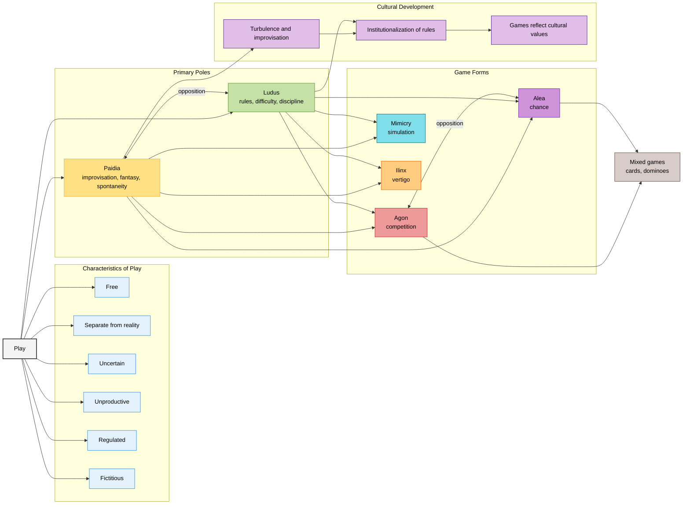

## Huizinga
- Homo Ludens does not provide a specific classification and description of games. 
- Huizinga focuses instead on the importance of the role of play in the development of civilization. For this reason, he classifies games into four broad categories.

## Roger Caillois, Games and Men, Masks and Vertigo, Mexico, FCE. (1986)
- play is an activity characterized by *being free*, *separate from reality*, uncertain, unproductive, regulated, and fictitious:
	- *Free*: no one can force you to play; it is a free and voluntary activity.
	- *Separate from reality*: it is separated from everyday life in a specific space and time.
	- *Uncertain*: the outcome of the game is not determined; doubt plays a fundamental role.
	- *Unproductive*: no goods or wealth are created outside the game; when it ends, things start again as they did the first time.
	- *Regulated*: it has precise, arbitrary, non-ordinary rules for carrying out the activity.
	- *Fictitious*: a **secondary reality** in which the game is played, fantasy is the main element.

Caillois makes a primary classification of games, in which there are only two categories:
·**Paidia**: activities related to fun, with improvisation, full of fantasy, commonly known as children's games.
·**Ludus**: activities with difficulty in reaching the final result, involving ingenuity, skill, dexterity, and patience. They have more complex rules.

Within these two opposite poles, we find a subcategory of games related to the predominance of competition, chance, simulation, or vertigo:
·**Agon** (competition): These are games that appear as a struggle where artificial equality is created, with antagonists facing each other under ideal conditions. These types of games require training, discipline, and perseverance. Examples: soccer, chess.
·**Alea** (luck): In these games, participants try to be favored by fate. They serve to abolish the natural or acquired qualities of individuals, leaving them on an absolutely equal footing in the face of luck. It is chance. Examples: dice, coin tossing.
·**Mimicry**: The subject plays at believing, at making themselves believe or making others believe that they are different from themselves. It is not regulated; this characteristic is replaced by the concealment of reality and the simulation of a second reality, the act of "pretending." Examples: theatrical performance and dramatic interpretation.
·**Ilinx** (vertigo): This brings together games that consist of an attempt to destroy the stability of perception for a moment and inflict a kind of voluptuous panic on the lucid consciousness, that is, players seek to stun themselves by abruptly annihilating reality. Example: spinning around, Six Flags, amusement park rides.

**Opposition between agon and alea**: There are exceptions such as cards or dominoes, which combine agon and alea, since the hand is obtained by luck and its use depends on skill.

From turbulence to rules: When the game acquires an institutional existence, the rules become part of its nature, becoming a fertile and decisive instrument of culture. Games exemplify the moral and intellectual values of a culture, as well as contributing to their refinement and development.

