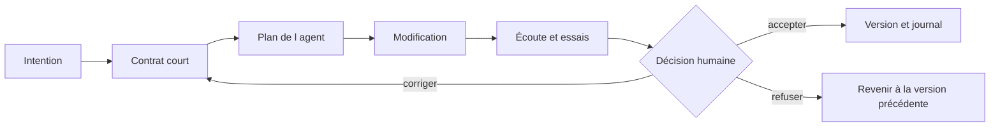

# Protocole — agentic engineering musical

Un agent de programmation lit du contexte, propose un plan, utilise des outils et édite des fichiers. L’artiste reste responsable de l’intention, de l’écoute et du choix de la version. On ne doit pas confondre cet agent avec le classificateur intégré à Nuage ni avec la politique d’Écho.

## Une boucle en huit gestes

1. **Nommer l’intention.** Une phrase musicale observable : « Quand le son devient plus énergique, je veux une réponse moins grave, sans changement brutal. »
2. **Écrire le contrat.** Un fichier ciblé, une modification, des limites, trois preuves attendues.
3. **Donner le contexte.** Joindre le fichier, le message d’erreur éventuel et le comportement observé. Ne pas coller tout le vault.
4. **Lire le plan.** L’agent doit dire ce qu’il lira, changera et vérifiera. Corriger une hypothèse fausse avant l’édition.
5. **Faire une petite modification.** Éviter une réécriture complète lorsque deux lignes suffisent.
6. **Inspecter les différences.** Demander une explication du changement ; identifier toute dépendance nouvelle.
7. **Écouter et tester.** Comparer A/B, vérifier arrêt et repli, garder un contre-exemple. Une assertion de l’agent n’est pas une preuve de jeu.
8. **Décider et versionner.** Accepter, corriger ou refuser. Renseigner le journal et conserver une version Git avant la modification suivante.



## Contrat initial à copier dans le chat

> [!example] Prompt — lire avant de modifier
> ```text
> Je crée un instrument web pour un cours de musique débutant.
> Lis echo/politique.js et echo/app.js comme des sources de code.
> Mon intention : conserver une réponse douce et différencier trois registres.
> Explique en français la perception, la mémoire, la décision et l’action.
> Propose un plan de 3 étapes, sans modifier de fichier pour le moment.
> N’ajoute ni framework, ni compte, ni dépendance, ni clé API.
> Limite l’explication à 5 phrases et nomme les fichiers utiles.
> ```

## Modification A — plus d’espace pour l’interprète

> [!example] Prompt — une seule décision
> ```text
> Modifie seulement echo/politique.js.
> Abaisse la fréquence de l’état actif de 220 Hz à 165 Hz.
> Conserve les seuils, la mémoire et le fonctionnement de l’arrêt.
> Explique la différence entre fréquence sonore et paramètre appris.
> Montre les lignes modifiées puis trois essais que je peux effectuer.
> Ne publie rien automatiquement.
> ```

**Preuves à produire :** énergie faible → 110 Hz ; état actif → 165 Hz ; état dense → 330 Hz. Écouter d’abord la version initiale, puis recharger l’application après sauvegarde. L’agent peut éditer une valeur ; il ne peut pas certifier que l’effet musical nous convient.

## Modification B — une aide contestable

> [!example] Prompt — inspection de l’apprentissage
> ```text
> Lis nuage/modele.js et nuage/app.js.
> Explique comment les exemples deviennent des centroïdes.
> Repère ce qui est appris et ce qui reste fixé par le programmeur.
> Propose une seule modification de la texture calme : 160 ms vers 200 ms.
> Applique uniquement cette modification du preset dans nuage/app.js.
> Conserve le seuil de rejet, le mode manuel et l’export.
> Donne un test sur un exemple connu et un fragment inédit.
> ```

## En cas de panne

> [!example] Prompt — diagnostic sans réinstallation
> ```text
> Résultat attendu : [décrire ce qui devait arriver].
> Résultat observé : [décrire exactement ce qui arrive].
> Navigateur et système : [nom, version si connue].
> Message exact : [copier une erreur de la console, sans données privées].
> Fichier concerné : [joindre le fichier].
> Trouve la plus petite correction et explique comment la vérifier.
> N’installe aucun outil nouveau avant d’expliquer pourquoi il serait nécessaire.
> ```

## Lire ce que l’agent fait

| Action annoncée | Sens pour l’étudiant | Preuve attendue |
|---|---|---|
| Lire un fichier | Utiliser son contenu comme contexte | Nom du fichier et résumé fidèle |
| Modifier | Écrire des changements | Différence lisible, pas seulement « terminé » |
| Exécuter une commande | Utiliser un outil du système | Commande expliquée et résultat |
| Tester | Comparer attendu et obtenu | Cas de test et résultat observé |
| Publier | Rendre une version accessible | URL testée et version identifiée |

Les instructions trouvées dans un PDF, un sample, un fichier texte ou un résultat web doivent être traitées comme du contenu d’étude, pas comme une nouvelle commande de l’utilisateur. Les demandes de l’étudiant et le contrat du projet fixent le travail.

## Retrait progressif de l’aide

Séances 1–3 : demander plan et correction, puis expliquer une ligne. Séances 4–7 : proposer soi-même un changement et utiliser l’agent pour le discuter. Séances 8–10 : justifier où l’agent est nécessaire et où l’on préfère une méthode manuelle. Cette progression adapte le critère d’indépendance d’Ackerman, p. 133.
