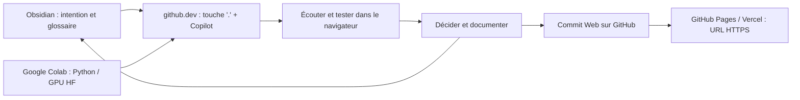

# Agentic Music MOC

## Parcours étudiant (100 % Cloud — Zéro Installation)

1. [[Programme - 10 séances]] — productions, lectures, progression et critères.
2. [[Installation - Windows et macOS]] — circuit cloud zéro installation (`github.dev`, Copilot Education, Google Colab, Pages/Vercel).
3. [[classe-01-machines-qui-ecoutent]] — séance 1 Advanced Slides avec `notes:` et [[Atelier 01 - deux applications]].
4. [[courses/agentic music/01-hf_audio_10_steps/slides_fr|01 — Modèles audio Hugging Face en 10 étapes (FR)]] · [[courses/agentic music/01-hf_audio_10_steps/slides_en|(EN)]] — exécuté sur Google Colab (`01_hf_audio_10_steps/hf_audio_10_steps_colab.ipynb`).
5. [[courses/agentic music/02-llm_webaudio_vexflow/slides_fr|02 — Modèles de langage gratuits, Web Audio & VexFlow (FR)]] · [[courses/agentic music/02-llm_webaudio_vexflow/slides_en|(EN)]].
6. [[courses/agentic music/03-photo_console_webaudio_matrix/slides_fr|03 — Photo-Console & Matrice Audio Multiplexer (FR)]] · [[courses/agentic music/03-photo_console_webaudio_matrix/slides_en|(EN)]] et [[Atelier 03 - Photo-Console et Matrice Audio]].
7. [[Protocole - agentic engineering]] — demander, inspecter, écouter, corriger et versionner.
8. [[Glossaire - protocole pédagogique]] — définitions FR/EN (IA, JS débutant et Web Audio API).
9. [[Journal - modèle étudiant]] — intention, interventions de l’agent, décisions et preuves.
10. [[Publication - GitHub Pages et Vercel]] — obtenir une URL testable sur téléphone depuis le navigateur.

## Organisation enseignante

- [[Organisation - conduite et évaluation]] — préparation, minutage, accessibilité et évaluation.
- [[Lectures - concepts et exercices]] — synthèse sourcée des deux livres.
- [[Ressources - modèles et datasets]] — parcours gratuit, quotas et extensions.
- [[Hyperphones - contrat de conception]] — exigences tirées du vault et critères de jeu.
- [[Présentation - format et maintenance]] — conventions des slides, notes et schémas.
- [[Audit - sources et vérification]] — périmètre de lecture et limites des validations.

## Applications et Notebooks livrés

- **Applications Séance 1 (`applications/index.html`)** :
  - **Écho des états** : microphone ou curseur → mémoire courte et règles → synthétiseur → export WAV.
  - **Nuage appris** : MP3/WAV ou micro → exemples étiquetés → petit classificateur appris → grains → export WAV/JSON.
- **Notebook Colab (`01_hf_audio_10_steps/hf_audio_10_steps_colab.ipynb`)** : 10 étapes Hugging Face Audio sur GPU T4 gratuit (AST, CLAP, Whisper, MusicGen et boucle agentique).
- **LLM + Web Audio + VexFlow (`02_llm_webaudio_vexflow/index.html`)** : partition JSON générée par chat LLM, synthétisée et gravée dans une page unique.
- **Photo-Console & Matrice Audio (`03_photo_console_webaudio_matrix/index.html`)** : découpe d'image en boutons rotatifs (Knobs) et faders polygonaux fléchés (Sliders), synthèse Additive / Soustractive / FM / Granulaire + Mic / Delay / Reverb et matrice multiplexer $7 \times 6$ avec feedback.

## Carte de circulation (Circuit Zéro-Installation)

## Repères d’avancement

| Élément | État |
|---|---|
| Plan de dix séances | Rédigé |
| Séance 1 et deux instruments (`applications/`) | Rédigés et testés |
| Module 01 HF Audio en 10 étapes (Slides FR/EN + Google Colab `.ipynb`) | Livré (100 % Colab) |
| Module 02 LLM + Web Audio + VexFlow (Slides FR/EN + `index.html`) | Livré |
| Module 03 Photo-Console & Matrice Audio (Slides FR/EN + `index.html` + Atelier 03) | Livré |
| Glossaire FR/EN (IA + JS débutant + Web Audio API) | 17 fiches livrées |
