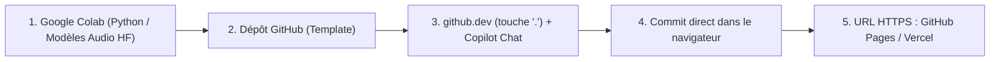

# Installation — Circuit 100 % Cloud (Zéro Installation)

**Principe du cours à la HEM : aucune installation de Python, Node.js, Git ni d'IDE lourd sur les ordinateurs des étudiants.** Tout le parcours se déroule dans le navigateur web via **Google [[colab]]**, **VS Code pour le Web (`[[github-dev]]` / Codespaces)**, et **[[github-pages]] / [[vercel]]**. Apporter simplement un casque, un navigateur récent (Chrome, Edge, Firefox ou Safari) et facultativement un téléphone.

## 1. GitHub Education & Copilot (Étudiants et Enseignant)

1. Créer un compte gratuit sur [GitHub](https://github.com) (ou utiliser son compte existant).
2. **Recommandation pour l'adresse courriel `@hesge.ch` (HEM) :** dans **Settings → Emails**, ajouter son adresse académique HEM comme courriel vérifié sur son compte GitHub principal (inutile de créer un second compte séparé), puis demander la vérification sur [GitHub Education](https://education.github.com/pack) (étudiants) ou [GitHub Teacher](https://education.github.com/teachers) (enseignant).
3. **Accès à [[copilot]] :**
   - Les comptes étudiants/enseignants vérifiés reçoivent gratuitement **GitHub Copilot Pro** et un quota mensuel **GitHub Codespaces** (180 heures-cœur/mois).
   - **Dès la 1re minute (sans attendre la validation Education) :** tout compte GitHub standard dispose déjà de **Copilot Free** (chat et éditions assistées directement dans le navigateur).

> [!important] GitHub n’est pas un GPU gratuit
> **GitHub Models a été retiré le 30 juillet 2026.** Pour faire tourner des modèles audio Python (Whisper, CLAP, AST, MusicGen), nous utilisons exclusivement **Google [[colab]]** (`01_hf_audio_10_steps/hf_audio_10_steps_colab.ipynb`) sur GPU T4 gratuit.

## 2. L’éditeur VS Code en ligne : `github.dev` (touche `.`) et Codespaces

Au lieu d'installer VS Code ou Git sur chaque machine :

1. **VS Code pour le Web (`[[github-dev]]`) — instantané :**
   - Ouvrir son dépôt sur `https://github.com/PSEUDO/agentic-music-prenom`.
   - **Appuyer sur la touche `.` (point) du clavier** (ou remplacer `github.com` par `github.dev` dans la barre d'adresse).
   - VS Code s'ouvre immédiatement dans le navigateur.
   - Ouvrir le panneau **Copilot Chat** pour poser des questions ou demander des modifications sur `index.html`.
   - Pour sauvegarder et publier : ouvrir l'onglet **Source Control** (icône de branche à gauche), écrire un message de commit et cliquer **Commit & Push**. Aucune commande terminal n'est requise.
2. **GitHub Codespaces — lorsque l'on souhaite un serveur de prévisualisation intégré :**
   - Sur la page du dépôt GitHub, cliquer **Code → Codespaces → Create codespace on main**.
   - Offre le même VS Code dans le navigateur avec prévisualisation live HTTPS et le mode **Copilot Agent** complet.

## 3. Exécuter les routines Python dans Google Colab

Pour la séance sur les modèles audio Hugging Face (`01_hf_audio_10_steps`) :

1. Ouvrir [Google Colab](https://colab.research.google.com/).
2. Charger le notebook `01_hf_audio_10_steps/hf_audio_10_steps_colab.ipynb` (depuis GitHub ou par import).
3. Choisir **Exécution → Modifier le type d'exécution → GPU T4**.
4. Exécuter les cellules 1 à 10 dans le navigateur. Les poids des modèles restent sur les serveurs de Google.

## 4. Ouvrir et publier les instruments Web Audio

1. Activer **[[github-pages]]** une seule fois dans le dépôt : **Settings → Pages → Source : Deploy from a branch → `main` / `/(root)` → Save** (ou relier le dépôt à **[[vercel]]**).
2. À chaque commit effectué dans `github.dev`, l'URL HTTPS (`https://PSEUDO.github.io/...`) se met à jour en quelques secondes.
3. On peut aussi télécharger un fichier autonome unique (`02_llm_webaudio_vexflow/index.html` ou `03_photo_console_webaudio_matrix/index.html`) et l'ouvrir directement dans Chrome, Firefox ou Safari.

## 5. Microphone dans le navigateur

| Système | Si le micro est refusé |
|---|---|
| Windows | **Settings → Privacy & security → Microphone** : autoriser le navigateur web |
| macOS | **System Settings → Privacy & Security → Microphone** : autoriser Chrome / Safari / Firefox |
| Navigateur | Cliquer l’icône à gauche de l’URL (`https://`) et autoriser le microphone |

Le microphone web exige un contexte sécurisé (`https://` sur GitHub Pages, Vercel ou Google Colab). Tous nos instruments (Écho, Nuage, Colab 01, Photo-Console 03) incluent un générateur ou son de démonstration intégré pour jouer même sans microphone.

## 6. Obsidian (consultation du cours et des slides)

Pour consulter le vault localement ou projeter les présentations **Advanced Slides** en classe : ouvrir le dossier `cursos/agentic music` dans [Obsidian](https://obsidian.md/download) et lancer **Advanced Slides: Show slide preview** (`Cmd+P` / `Ctrl+P`), puis appuyer sur `S` pour les notes de présentation.

