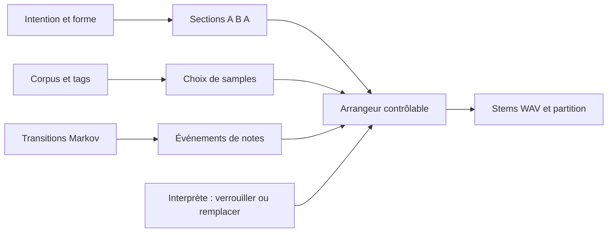

# Ressources — modèles, services et datasets

État des documentations contrôlé le **2 octobre 2026**. L’accès gratuit, les quotas et les disponibilités peuvent changer. L’objectif pédagogique conserve toujours un parcours local.

## Trois niveaux d’accès

| Niveau | Usage | Compte et coût | Limite pratique |
|---|---|---|---|
| 1. Navigateur local | Règles, centroïdes, synthèse, sampling | Aucun compte ni frais d’inférence | Petite capacité, pas de compréhension générale |
| 2. Modèle HF sur la machine | Transcription/classification avec Transformers.js | Poids publics téléchargés ; calcul local | Réseau au premier chargement, RAM/CPU variables |
| 3. Démo hébergée ou API | Essai ponctuel d’un modèle plus lourd | Conditions et quotas du service | File d’attente, panne, éventuelle facturation |

Le niveau 1 est le socle des dix séances. Le niveau 2 se prépare avec une seule référence testée. Le niveau 3 est une extension, sans abonnement exigé.

## GitHub et applications commerciales simples

- **Copilot Free / Student** : agent ou chat dans VS Code selon accès ; utile pour expliquer et éditer. Crédits limités ; la sélection automatique est le parcours indiqué pour Free/Student dans les [plans officiels](https://docs.github.com/en/copilot/get-started/plans).
- **Chat commercial déjà accessible** : utiliser uniquement pour demander variantes de paroles ou expliquer un fichier ; recopier les suggestions dans l’éditeur et documenter l’outil réellement utilisé. Aucun compte payant supplémentaire imposé, aucun quota gratuit universel annoncé.
- **GitHub Pages** : hébergement statique des instruments, sans serveur de modèles. [Configuration](https://docs.github.com/en/pages/getting-started-with-github-pages/configuring-a-publishing-source-for-your-github-pages-site).
- **Vercel Hobby** : alternative personnelle non commerciale à quotas. [Conditions du plan](https://vercel.com/docs/plans/hobby).
- **Audacity** : montage audio graphique Windows/macOS pour préparer les samples ; facultatif, car les références chargent et exportent des WAV. [Téléchargement officiel](https://www.audacityteam.org/download/).

GitHub Models est retiré depuis le 30 juillet 2026 : [documentation officielle](https://docs.github.com/en/github-models). Ne pas prévoir un TP utilisant son ancienne API.

## Hugging Face : accès réaliste

Les [Spaces](https://huggingface.co/docs/hub/spaces-overview) sont des démonstrations, pas une garantie de calcul gratuit. Au contrôle effectué, la documentation distingue les Static Spaces gratuits et les Spaces de calcul soumis à un plan, avec une exception limitée pour des Gradio ZeroGPU sur certains comptes gratuits en règle. Vérifier les conditions du compte au moment d’un TP ; ne pas demander à tous les étudiants de dupliquer une démo GPU.

Les [Inference Providers](https://huggingface.co/docs/inference-providers/pricing) ont des crédits d’essai limités et de la facturation après les crédits. La présence d’un modèle sur le Hub ne signifie pas qu’il est servi par une API gratuite.

| Modèle | But musical | Parcours retenu | Contraintes |
|---|---|---|---|
| [Xenova/whisper-tiny](https://huggingface.co/Xenova/whisper-tiny) | Transcrire une courte phrase chantée/parlée comme matériau de paroles | Transformers.js sur ordinateur, après essai préalable | Les transcriptions chantées peuvent être mauvaises ; faire corriger par l’étudiant ; pas un outil de partition polyphonique |
| [Xenova/clap-htsat-unfused](https://huggingface.co/Xenova/clap-htsat-unfused) | Comparer un sample à des descriptions proposées | Classifier hors boucle audio, mettre les résultats en cache | Poids et calcul plus lourds ; pas de reconnaissance émotionnelle certaine ; vérifier licence de la base [LAION](https://huggingface.co/laion/clap-htsat-unfused) |
| [facebook/musicgen-small](https://huggingface.co/facebook/musicgen-small) | Générer un fragment pour l’intégrer au sampler | Démo ou poste préparé par l’enseignant ; facultatif | 300M paramètres ; poids CC BY-NC 4.0 ; pas de génération temps réel garantie sur un portable ordinaire |

Bibliothèque : [Transformers.js](https://huggingface.co/docs/transformers.js/index). La documentation distingue branche de développement et version stable ; fixer la version retenue dans le projet. Les modèles ONNX navigateur ne sont pas interchangeables avec tous les modèles PyTorch.

## Mini-parcours HF sans programmation, option de découverte

1. Ouvrir la fiche [MusicGen small](https://huggingface.co/facebook/musicgen-small).
2. Repérer tâche, taille, licence et limites. Noter ces éléments dans le journal.
3. Ouvrir la [démo MusicGen](https://huggingface.co/spaces/facebook/MusicGen), contrôlée comme page accessible ; sa génération n’a pas été validée ici.
4. Si elle est disponible et votre quota le permet, demander un fragment bref, par exemple une texture instrumentale clairsemée. Commencer par la durée minimale proposée.
5. Télécharger l’audio généré, noter prompt, date et modèle/variante réellement indiqués par la démo. La démo peut utiliser une autre taille que small : ne pas les confondre.
6. Importer le fichier dans Nuage et décider quelles parties garder. Le modèle devient une source parmi d’autres, pas un producteur de l’œuvre entière.
7. Si la démo est en attente, indisponible ou demande un paiement, utiliser un son original et conserver le même exercice de sélection. Aucune attente de GPU n’est requise pour terminer le cours.

## Datasets pour un DIY contrôlable

| Corpus | Ce qu’il permet | Usage en atelier |
|---|---|---|
| **Corpus personnel de 8–12 sons** | Sampling, tags, granularité, apprentissage de catégories | Prioritaire ; petits fichiers originaux, sources et choix connus |
| [MAESTRO](https://magenta.tensorflow.org/datasets/maestro) | Performances piano et MIDI aligné | Sous-ensemble MIDI préparé par l’enseignant ; analyse de transitions, pas transfert automatique de style ; licence indiquée CC BY-NC-SA 4.0 |
| [ESC-50 sur HF](https://huggingface.co/datasets/ashraq/esc50) | Sons environnementaux et classes | Quelques exemples préparés ; étudier le classement et ses limites ; relire les attributions originales et la licence du sous-ensemble choisi |
| **Mini-corpus de paroles originales** | Grammaire, recherche de mots, composition vocale | 8–20 lignes écrites par les étudiants ; aucune collecte massive de paroles commerciales |

Lire la fiche dataset et celle de chaque ressource lorsqu’elles diffèrent. La mise à disposition d’un corpus ne garantit pas un droit de republication de tous ses enregistrements.

## Forme minimale du DIY Suno

Éléments séparables : paroles, événements, samples, forme et rendu. L’agent aide à écrire les convertisseurs ; le compositeur valide les sections. Ce système pédagogique n’imite pas la capacité d’un service commercial de génération complète.

## Partition et réseau

[VexFlow](https://www.vexflow.com/) rend la notation web ; [LilyPond](https://lilypond.org/download.html) grave des fichiers hors du navigateur. WebRTC transporte des messages ou médias entre pairs, mais requiert une signalisation et parfois un relais. Préparer le serveur/relais de classe avant de promettre un duo entre réseaux distants ; conserver le repli à deux onglets.
