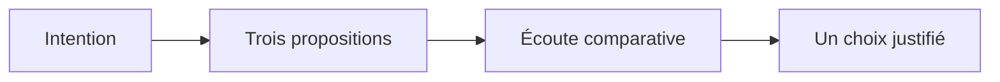
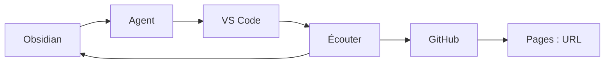
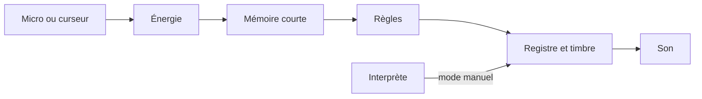

## Agentic Music — machines qui écoutent

| Séance | Format | Cours |
|---|:---|---:|
| **01** | Atelier de 3 h | *Internet Music · 2026–2027* |

# Fabriquer. Écouter. Décider.

Deux instruments, une intention, des décisions que l’on peut expliquer.

notes:
Ouvrir les deux instruments dans le navigateur externe avant le début. L’en-tête reprend la structure de la classe de référence. Les diagrammes Mermaid remplacent les images distantes pour que le sens ne dépende pas d’un lien disponible. Ne pas commencer par l’installation d’un framework. Faire entendre deux textures très brèves à faible volume. Annoncer : aujourd’hui nous transformons des références jouables, puis nous publions une version personnelle. Les notes qui suivent chaque diapositive sont réservées au mode présentateur. Les étudiants disposent du guide Atelier 01, qui contient le pas à pas complet.

---

## À la fin de la séance

- Jouer **Écho des états** et **Nuage appris**.
- Modifier une décision avec un agent de programmation.
- Partager une URL et exporter deux WAV.
- Expliquer une proposition acceptée et une proposition refusée.

notes:
Objectif observable : chaque binôme sait montrer une entrée, un état et une action sonore. La qualité ne se mesure pas au volume de code généré. Les WAV servent de preuves d’écoute ; ils ne remplacent pas l’instrument. Si le cours dispose seulement de deux heures, utiliser les instruments préparés, concentrer l’édition sur une valeur et déplacer le second export et le déploiement à domicile avec le guide. Ne pas présenter une publication non effectuée comme une réussite.

---

## Écoute avant vocabulaire

Écouter deux réponses à une même matière.

**Quelle décision aimeriez-vous garder ?**

Une note, un silence, un moment, une texture…

notes:
0–15 minutes. Faire jouer Écho en mode curseur, énergie faible puis forte. Dans Nuage, charger la démo et comparer grains de 40 et 160 ms en manuel. Recueillir des observations musicales, sans introduire RMS ou réseau neuronal. Chaque étudiant formule une intention en une phrase. Ce sont des questions de discussion, pas des commandes à transmettre automatiquement à un agent. Relier l’écoute au critère de valeur présenté par Ackerman, p. 20–21.

---

## Deux partenaires de lecture

**Maya Ackerman** — *Creative Machines: AI, Art & Us* (2026)

Explorer des possibles ; choisir une aide qui soutient notre expression.

**Emily K. Johnson / Anastasia Salter** — *Critical Making in the Age of AI* (2025)

Fabriquer, transformer un patron et discuter ses effets.

notes:
15–20 minutes. Les références viennent des deux fichiers fournis. Nom exact : Maya Ackerman. Ne pas distribuer les PDF dans le dépôt étudiant. Les pages citées dans la présentation sont imprimées : ajouter 12 pour le PDF d’Ackerman et 15 pour Johnson/Salter. Préciser que nos exercices musicaux adaptent les arguments des auteurs ; les livres ne fournissent pas les deux applications livrées.

---

## Explorer puis sélectionner



Ackerman, p. 22–24 : divergence et convergence.

notes:
Inviter à différer le jugement pendant la proposition de trois idées, puis à resserrer selon un critère audible. Éviter de transformer cette distinction en algorithme universel de créativité : le livre insiste sur leur alternance. Exercice du cours : trois politiques de réponse à une pièce sonore, une seule implémentée. Ne pas attribuer cet exercice précis au livre. Si Mermaid ne rend pas correctement, le texte donne déjà les quatre étapes.

---

## Une machine que l’on peut contester

- Une aide **désactivable**.
- Des propositions **modifiables**.
- Un apprentissage qui accroît notre **indépendance**.
- Une interface qui facilite le **jeu**.

Ackerman, p. 131–134.

notes:
Présenter les quatre critères exacts de la machine humble : flexibilité, apprentissage et indépendance, créativité, facilité d’usage. Nos quatre points à l’écran sont une traduction en exigences de conception, pas une citation. Désactiver un modèle ne suffit pas à prouver sa créativité. Questionner sa contribution : propose-t-il quelque chose de nouveau et de pertinent pour l’interprète ? Cette séance n’établit pas qu’un classificateur de deux variables est une machine créative au sens fort.

---

## Fabriquer pour comprendre

**Question → patron → transformation → critique**

Aujourd’hui, transformer un réglage puis faire jouer l’instrument à un partenaire.

Johnson et Salter, p. 12–16.

notes:
Le livre organise ses chapitres en cadre critique, patron, applications et futurs. La séquence affichée est notre adaptation pédagogique. Souligner la construction de savoir par expérience et l’attention aux outils gratuits, aux communautés et aux dépendances de plateforme. Montrer une panne comme occasion d’enquête. Demander que la transformation ait une conséquence musicale identifiable.

---

## Deux emplois différents de l’IA

| Pour fabriquer l’instrument | À l’intérieur de l’instrument |
|---|---|
| Un agent lit et édite des fichiers | Une politique choisit une action sonore |
| Nous inspectons le changement | Nous observons et corrigeons la décision |

**Écho : règles écrites. Nuage : valeurs apprises.**

notes:
20–25 minutes. C’est la distinction centrale. L’agent de programmation peut utiliser un LLM ; Écho n’appelle pas ce LLM pour jouer. Nuage utilise un classificateur local à centroïdes, sans poids préentraînés. Un programme interactif n’est pas automatiquement appris. Un agent peut être déterministe : perception, état, but et action sont plus utiles ici que l’idée de mystère ou d’indétermination absolue. Les modèles HF plus lourds arrivent après les bases, en séance 9.

---

## Concept 1 — agent

> [!info] Agent / Agent
> **FR :** Système qui poursuit un objectif par une boucle de contexte, décision et action.
> **EN:** A system that pursues a goal through a loop of context, decision, and action.

Montrer une action de l’agent et une décision de l’artiste.

notes:
Un agent de programmation dispose d’outils qui peuvent lire, écrire ou exécuter. L’étudiant peut borner sa tâche à un fichier. L’agent sonore de la première application a une mémoire d’énergie et une politique de registres. Nommer ces deux niveaux sans prétendre qu’ils sont identiques. Fiche Concept - Agent pour le contre-exemple et la vérification. L’explication se limite ici à une minute.

---

## Notre chaîne de travail



Le journal garde l’intention et les choix.

notes:
25–30 minutes. Montrer les fenêtres réelles : note Obsidian, copie locale des applications dans VS Code, navigateur. Le dépôt étudiant doit contenir les seuls fichiers d’applications et sa documentation publique. Vercel est une alternative ; il n’est pas nécessaire aujourd’hui. Ne pas déployer tout le vault avec ses notes enseignantes et ses livres.

---

## Préparer les outils

1. Ouvrir le vault dans Obsidian.
2. Ouvrir une **copie de `applications/`** dans VS Code.
3. Installer Live Server ; ouvrir `index.html`.
4. Activer le chat et vérifier le compte GitHub.

Guide : [[Installation - Windows et macOS]].

notes:
30–40 minutes, si la préparation n’a pas été faite. Décrire la copie comme un dossier autonome nommé agentic-music-prenom : elle contient echo, nuage, commun et assets. Windows et Mac suivent les mêmes étapes graphiques. Live Server évite de demander Node/Python. Ouvrir le site dans un navigateur externe ; l’aperçu embarqué de l’éditeur peut imposer des restrictions au micro. Vérifier que la démo charge par URL locale.

---

## GitHub Education : ce qu’il permet

- Un compte étudiant vérifié peut accéder à **Copilot Student**.
- **Copilot Free** offre un parcours limité sans validation étudiante.
- GitHub garde les versions ; Pages publie les fichiers.

> [!important] Mise à jour du 2 octobre 2026
> GitHub Models a fermé le **30 juillet 2026**.

[Source officielle](https://docs.github.com/en/github-models)

notes:
40–43 minutes. Correction essentielle d’anciens guides : le playground et l’API GitHub Models ne sont plus un parcours disponible. Copilot est distinct. Selon la documentation des plans consultée, Free et Student utilisent la sélection automatique de modèles et ont des crédits limités. Ne pas afficher de quota numérique durable ni promettre de GPU. Les instruments peuvent être joués et modifiés manuellement si le compte manque. Les ressources techniques recensent les options HF.

---

## Concepts 2 et 3 — prompt, token

> [!info] Prompt / Prompt
> **FR :** Consigne, contexte et résultat attendu donnés au modèle.
> **EN:** An instruction, context, and expected result given to a model.

> [!info] Token / Token
> **FR :** Unité de texte traitée par le modèle, souvent un fragment de mot.
> **EN:** A text unit processed by a model, often part of a word.

notes:
43–47 minutes. Un prompt précis n’assure pas une sortie correcte ; il la rend plus vérifiable. Un token n’est pas systématiquement un mot. Le contexte joint compte aussi dans le budget. Ne pas introduire aujourd’hui les tokens audio ; signaler uniquement que le token d’accès secret est un autre usage du mot. Remplir les exemples dans le glossaire. Limiter à deux fiches travaillées, les autres étant déjà préparées.

---

## Le premier contrat avec l’agent

> [!example] À copier dans le chat VS Code
> ```text
> Lis echo/politique.js et echo/app.js.
> Explique perception, mémoire, décision et action en 5 phrases.
> Propose un plan de 3 étapes, sans modifier de fichier.
> N’ajoute ni dépendance, ni compte, ni clé API.
> ```

Joindre les deux fichiers au contexte.

notes:
47–52 minutes. Dans la vue Chat, choisir Ask pour expliquer, puis Agent lorsque l’édition sera souhaitée et accessible. Les noms de modes peuvent changer ; s’appuyer sur l’interface disponible. Si le compte ne propose pas de mode agent, le chat peut suggérer un changement que l’étudiant applique à la main. Ne pas exiger un modèle spécifique en plan gratuit. Faire vérifier si la réponse décrit réellement le fichier, plutôt qu’une explication générique.

---

## Application 1 — Écho des états

**Entrée :** microphone ou énergie simulée.

**Décision :** calme / actif / dense, avec mémoire courte.

**Sortie :** une voix de synthèse et un WAV.

Ouvrir `echo/index.html` depuis l’accueil des applications.

notes:
52–57 minutes. Démontrer d’abord la source curseur. Le mic ne doit pas être requis pour participer. Une mémoire lissée et une attente de 600 ms évitent certains basculements brusques ; des seuils différents d’entrée/sortie produisent une hystérésis. Ces détails peuvent rester dans les notes. Le micro n’est pas branché directement aux haut-parleurs ; on analyse son niveau pour jouer une synthèse. Mettre un casque si possible.

---

## Le parcours d’Écho



Une politique explicite, sans modèle appris.

notes:
Le niveau n’est ni le nom de l’instrument ni l’intention du musicien. Le système mesure l’amplitude et la lisse ; c’est un choix extrêmement réduit de perception. Expliquer la valeur de la limite : on peut comprendre et contester cette politique. L’action produit des notes brèves périodiques. Le but pédagogique est de rendre audible le changement d’état, pas d’obtenir une reconnaissance générale de la pièce.

---

## Jouer Écho — pas à pas

1. Choisir **Curseur**, cliquer **Démarrer**.
2. Passer l’énergie de 0.10 à 0.40 puis 0.90.
3. Déplacer X pour le panorama, Y pour le volume.
4. Désactiver la politique et choisir un état manuel.
5. **Arrêter**, puis redémarrer.

notes:
57–65 minutes. Laisser plusieurs secondes par énergie pour observer le lissage et le délai minimal entre états. Les transitions attendues sont calme, actif, dense. Le plan spatial suit les notes d’hyperinstrument du vault : X panorama, Y volume ; Shift maintient le volume pendant le geste X. Les sliders sont l’alternative clavier. Ne pas juger une absence de changement après seulement une fraction de seconde. Faire dire ce qui était manuel et ce qui était décidé automatiquement.

---

## Essayer le micro

1. Arrêter et choisir **Microphone**.
2. Démarrer, autoriser l’accès.
3. Ajuster la sensibilité, puis varier votre geste sonore.
4. Arrêter : l’indicateur d’utilisation du micro doit s’éteindre.

Sans permission, revenir au curseur.

notes:
65–70 minutes. L’accès nécessite HTTPS ou localhost et les permissions système. Un site chargé par une adresse IP HTTP du réseau local peut échouer sur téléphone ; l’URL publiée résout ce cas. Vérifier source d’entrée et micro occupé. Ne pas laisser les étudiants plusieurs minutes bloqués sur l’accès : le curseur conserve le même objectif. Le refus doit être nommé dans le journal, sans prétendre à un test micro réussi.

---

## Concept 4 — paramètre

> [!info] Paramètre / Parameter
> **FR :** Valeur qui règle un fonctionnement ; certaines valeurs d’un modèle sont apprises.
> **EN:** A value that controls a process; some model values are learned.

**220 Hz :** réglage du synthétiseur.

**Centroïde :** valeur calculée à partir d’exemples.

notes:
70–73 minutes. C’est une confusion fréquente : le nombre de paramètres d’un modèle ne compte pas ses boutons. Aujourd’hui 220 Hz est écrit dans une table de voix. Dans Nuage, le centroïde est calculé à partir des fragments étiquetés, mais les mappings label → texture sont encore écrits par nous. Demander de montrer un paramètre modifiable puis de distinguer qui l’a choisi.

---

## Modifier une seule décision

> [!example] Prompt — registre actif
> ```text
> Modifie seulement echo/politique.js.
> Remplace 220 Hz par 165 Hz pour l’état actif.
> Conserve les seuils et les autres états.
> Montre les lignes modifiées et trois essais manuels.
> ```

Sauvegarder, recharger, écouter A/B.

notes:
73–82 minutes. Si la génération automatique n’est pas accessible, localiser actif:{hz:220…} et remplacer la valeur à la main. Le contrat évite une réécriture complète. Lire la différence dans VS Code. Le rechargement coupe le moteur audio : redémarrer volontairement. Écouter 110/165/330 pour constater une différence de registre ; ne pas accepter la phrase de l’agent « tous les tests passent » si aucun essai n’a été réalisé. Conserver dans le journal le prompt et la raison musicale.

---

## Ce que l’agent doit montrer

| Action | Preuve |
|---|---|
| Lire | Un résumé fidèle du fichier |
| Éditer | Les lignes changées |
| Tester | Attendu et observé |
| Terminer | Ce qui reste à essayer |

Un agent peut écrire du code ; **nous évaluons l’écoute**.

notes:
82–87 minutes. Relier aux pratiques critiques de Johnson et Salter. L’étudiant doit pouvoir expliquer le changement en deux phrases. L’agent n’a pas accès automatiquement au rendu sonore de notre navigateur. Distinguer contrôle de syntaxe et essai du fonctionnement ; un fichier bien formé peut ne produire aucun son. Exiger le cas arrêt/redémarrage après toute modification du moteur.

---

## Exporter Écho

Jouer au moins 12 secondes.

Cliquer **Exporter 12 s en WAV**.

Écouter le fichier et noter :

**« Reconstruction des décisions de synthèse ; voix non enregistrée. »**

notes:
87–90 minutes. Le rendu offline reconstruit les événements de notes stockés récemment, avec les gains et panoramas. Si le jeu est plus court, le fichier de 12 s est complété par du silence. Le fichier n’est pas une capture du microphone. Importer ce WAV dans Nuage permet de relier synthèse et sampling. L’application initiale exporte son dernier historique ; le journal doit préciser si l’écoute a été suffisamment longue.

---

## Pause — écouter autrement

Dix minutes.

Avant de reprendre : une proposition gardée, une proposition à corriger.

notes:
90–100 minutes. Couper les instruments avant la pause. Demander aux binômes de noter une phrase, sans remplir toute la grille. Préparer Nuage dans l’onglet suivant et vérifier que les exemples peuvent être effacés pour une démonstration neuve.

---

## Application 2 — Nuage appris

**Matière :** votre WAV, un MP3 ou quatre secondes de micro.

**Apprentissage :** vos fragments et vos étiquettes.

**Jeu :** grains, position, volume et aide désactivable.

Ouvrir `nuage/index.html` depuis l’accueil.

notes:
100–105 minutes. Ne pas télécharger un modèle lourd pour cette activité. Nuage est un exemple de petit apprentissage supervisé local, réellement calculé à partir des exemples. Il n’appelle pas une API. Les grains sont de courts extraits enveloppés du buffer, non des sons halluciné par un réseau. Le mode manuel est musicalement utilisable avant tout apprentissage. On peut importer le WAV d’Écho ou commencer par la démo originale.

---

## Concept 5 — modèle

> [!info] Modèle / Model
> **FR :** Représentation calculable qui transforme des entrées en sorties selon des règles ou des valeurs apprises.
> **EN:** A computable representation that maps inputs to outputs using rules or learned values.

Nuage apprend des moyennes ; il ne reconnaît pas des émotions.

notes:
105–108 minutes. Le fichier modele.js calcule amplitude RMS et taux de passages par zéro sur un fragment de 250 ms. Le modèle stocke deux moyennes par classe. Les distances utilisent des échelles fixes, publiées dans le JSON. Ces choix sont très limités et sensibles à la source. Il faut un minimum de deux catégories pour activer l’aide ; idéalement trois exemples distincts par classe. Garder les sigles en notes aujourd’hui ; les définir en séance 3.

---

## Charger et écouter un fragment

1. Cliquer **Charger la démo**, ou importer le WAV d’Écho.
2. Déplacer **Position**.
3. Cliquer **Écouter ce fragment**.
4. Repérer deux ou trois matières différentes.

La capture micro est une alternative facultative.

notes:
108–113 minutes. Démo de 9 s : 0–3 sinus grave, 3–6 son harmonique, 6–9 bruit. L’interface positionne le début de la fenêtre d’analyse et limite la fin pour garder un fragment exploitable. Les imports sont bornés à 20 Mo et 60 s. Une nouvelle source efface les exemples pour éviter d’attribuer des centroïdes d’un corpus à un autre sans le dire. La capture automatique dure quatre secondes, puis ferme les pistes ; on peut l’arrêter immédiatement avec Arrêter tout.

---

## Enseigner deux ou trois catégories

1. Vers **0.5 s**, choisir **Calme**, ajouter l’exemple.
2. Vers **4 s**, choisir **Actif**, ajouter l’exemple.
3. Vers **7 s**, choisir **Dense**, ajouter l’exemple.
4. Ajouter des fragments voisins, mais distincts.
5. Cocher **Utiliser le modèle appris**.

notes:
113–122 minutes. Ces positions concernent la démo uniquement. Pour un WAV personnel, décider de ses catégories à l’écoute. Deux catégories sont le minimum ; trois exemples par catégorie améliorent la discussion. Ne pas nommer ces labels comme des propriétés objectives. Les étudiants peuvent qualifier un bruit de calme : le système apprend alors leur convention. Afficher les moyennes dans Centroïdes appris et limites pour montrer qu’un changement d’exemple modifie des nombres réels.

---

## Concept 6 — inférence

> [!info] Inférence / Inference
> **FR :** Utilisation d’un modèle existant sur une nouvelle entrée.
> **EN:** The use of an existing model on a new input.

Apprendre : ajouter des exemples.

Inférer : proposer une catégorie pour un autre fragment.

notes:
122–125 minutes. Réserver un fragment non utilisé pour apprendre. Relever attendu/prédit. En présence d’un fragment éloigné de tous les centres, Nuage repasse aux paramètres manuels au-delà de trois unités ; ce seuil est une règle de conception, pas une calibration de confiance statistique. Ne pas annoncer une précision à partir des exemples d’apprentissage. Introduire plus tard une séparation formelle apprentissage/test.

---

## Jouer les grains

1. Cliquer **Jouer les grains**.
2. X choisit la position ; Y règle le volume.
3. Écouter les changements de catégorie.
4. Désactiver l’aide, régler taille et densité à la main.
5. Réactiver : l’aide vous apporte-t-elle quelque chose ?

notes:
125–131 minutes. L’adaptation de X vers la position est annoncée ; elle diffère du panorama d’Écho tout en gardant Y volume. Les presets initiaux sont calme 160 ms/5 grains/s, actif 90 ms/11, dense 40 ms/20. Le petit ordonnanceur anticipe les grains sur l’horloge audio, mais un navigateur n’est pas une garantie de temps réel dur. On limite la densité et le gain. Montrer arrêt et reprise ; pas de promesse de conservation du son en onglet masqué.

---

## Une erreur devient un exercice

Choisir un fragment inédit.

Comparer **votre étiquette** et **la proposition du modèle**.

Ajouter un contre-exemple, puis comparer de nouveau.

Conserver l’erreur dans le journal.

notes:
131–135 minutes. Ce moment relie apprentissage et fabrication critique. Une erreur n’exige pas immédiatement un modèle plus gros : peut-être nos catégories se recouvrent-elles, notre descripteur ignore-t-il la hauteur ou notre corpus manque-t-il de variation. Dans cette version, RMS/ZCR peuvent mal distinguer certaines sources. Noter une limite technique et son effet sur le jeu, sans faire semblant de reconnaître des styles ou des émotions.

---

## Exporter Nuage

- **Scène WAV** : 12 s avec les paramètres actuels.
- **Source WAV** : matière sonore décodée.
- **Modèle JSON** : exemples et centroïdes inspectables.

Le WAV de scène fige les réglages ; il ne capture pas les gestes.

notes:
135–140 minutes. L’export rend une scène de paramètres figés par OfflineAudioContext. Le WAV source convertit le buffer décodé, sans promettre un encodage MP3. Le JSON décrit la méthode et les échelles ; l’application n’a pas encore de fonction de réimportation. Faire écouter le résultat avec une autre application. Une forme d’onde visible et un téléchargement ne prouvent pas à eux seuls qu’un WAV est audible.

---

## Concepts 7 et 8 — API, dépôt

> [!info] API / API
> **FR :** Interface qui permet d’utiliser les fonctions d’un autre composant.
> **EN:** An interface for using another component’s functions.

> [!info] Dépôt / Repository
> **FR :** Fichiers d’un projet et historique de leurs versions.
> **EN:** Project files and their version history.

notes:
140–144 minutes. Web Audio API est locale au navigateur ; API n’implique pas abonnement. Le dépôt peut être local avant GitHub. Pages publie un site à partir des fichiers ; ce n’est pas la même chose que garder des versions. Ce sont les deux derniers concepts de la séance. Ne pas ajouter une définition complète de serveur, HTTPS, Worker ou JSON à l’écran aujourd’hui ; le guide suffit pour effectuer les actions.

---

## Le protocole agentic engineering

**Intention → contrat → plan → édition**

**Différences → écoute → décision → version**

Une modification, trois essais, une explication.

[[Protocole - agentic engineering]]

notes:
144–150 minutes. Demander au binôme de choisir une modification d’Écho ou de Nuage. Le protocole complet possède deux exemples de prompt. Une seule modification en classe suffit. Ceux qui avancent vite peuvent demander de modifier uniquement le preset calme de Nuage de 160 à 200 ms. Une demande de nouvelle librairie doit être justifiée ; aucun besoin pour cette séance. Insister sur le retour à une version connue quand une modification échoue.

---

## Inspecter, tester, garder

| Essai | Résultat attendu |
|---|---|
| Aide désactivée | Un instrument encore jouable |
| Arrêt puis reprise | Pas de son ni micro résiduel |
| Fragment inédit | Une proposition ou un repli visible |

Le journal note le résultat observé.

notes:
150–157 minutes. Réserver le test sur un fragment inédit à Nuage. Pour Écho, vérifier l’énergie faible puis forte et le manuel. Les attentes doivent être connues avant les résultats. Les étudiants ne sont pas invités à écrire une suite de tests logiciels complète en séance 1 ; ils font des essais musicaux et fonctionnels documentés. Les tests fournis par le cours restent dans l’audit de préparation de l’enseignant.

---

## Garder une version avec Git

> [!info] Terminal dans la copie du projet
> ```bash
> git diff
> git add echo/politique.js
> git commit -m "Choix du registre après écoute"
> git push
> ```

Ou utiliser **Source Control** dans VS Code.

notes:
157–162 minutes. Ces commandes supposent que le dépôt a déjà été initialisé et relié à GitHub : suivre d’abord le guide Publication, parcours B. Si la classe a choisi l’upload sans terminal, conserver ce parcours au lieu de mélanger deux initialisations. git add doit cibler le fichier réellement modifié ; remplacer par nuage/app.js si nécessaire. Expliquer chaque commande simplement : inspecter, sélectionner, mémoriser, partager. Ne jamais forcer un push pour contourner une erreur de débutant.

---

## Publier une URL sur Pages

1. Copier les applications dans un dépôt étudiant public.
2. **Settings → Pages → Deploy from a branch**.
3. Choisir **main**, **/(root)**, puis **Save**.
4. Ouvrir l’URL HTTPS sur un autre appareil.

[[Publication - GitHub Pages et Vercel]]

notes:
162–170 minutes. Le dossier doit avoir index.html à la racine. Les sous-dossiers et le WAV original doivent être présents. Pages Free publie depuis un dépôt public ; avertir concrètement que les fichiers choisis seront visibles. Ne pas uploader le vault ni les PDF. Suivre la fin du workflow de publication, puis tester l’URL. Si le délai de build dépasse le temps de classe, journal « publication en cours » et terminer avec le guide.

---

## Tenir un glossaire vivant

**Huit notions maximum aujourd’hui. Deux fiches à compléter.**

Définition FR/EN → exemple musical → contre-exemple → preuve.

Expliquer une fiche à un partenaire en 30 secondes.

[[Glossaire - protocole pédagogique]]

notes:
170–175 minutes. Les fiches de base sont dans glossaire/. Demander une reformulation personnelle plutôt qu’une copie intacte. L’équivalent anglais et la définition anglaise servent à lire les interfaces et documentations ; le reste du journal et du cours reste en français. Le statut passe de rencontré à testé puis expliqué. Accepter une explication qui montre une action dans l’instrument, même si elle ne reproduit pas le vocabulaire exact.

---

## Rendu et critères

- Une URL jouable et deux WAV.
- Un JSON d’exemples de Nuage.
- Un changement de code expliqué.
- Deux fiches de glossaire.
- Une décision gardée, une proposition refusée ou corrigée.

[[Journal - modèle étudiant]]

notes:
175–178 minutes. La grille organisationnelle pondère musique 30 %, fonctionnement 25 %, explication 20 %, démarche critique 15 %, documentation 10 %. Pour le rendu de première séance, donner une rétroaction formative, sans note définitive de concert. Le refus peut porter sur une proposition musicale ou une suggestion d’édition ; ne pas inventer un refus si l’étudiant n’a reçu qu’une proposition. Il peut alors comparer les deux choix rejetés dans l’exercice divergence/convergence.

---

## La prochaine matière

Pour la séance 2 : préparer huit sons courts.

Un geste, un objet, un lieu, un silence choisi…

**Quel portrait sonore votre instrument pourrait-il raconter ?**

notes:
178–180 minutes. Relier au patron Selfie de Johnson/Salter, p. 23–42. Rappeler provenance et consentement pour des sons de personnes. Les sons peuvent être synthétiques ou originaux ; une captation de l’espace n’est pas la seule possibilité. Terminer par une écoute, pas par une accumulation de nouveaux outils. Indiquer aux étudiants que la première version n’a pas besoin d’un modèle distant pour être un projet valable.
