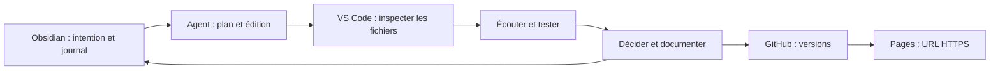

# Agentic Music MOC

## Parcours étudiant

1. [[Programme - 10 séances]] — productions, lectures, progression et critères.
2. [[Installation - Windows et macOS]] — préparer les outils et ouvrir les applications.
3. [[classe-01-machines-qui-ecoutent]] — présentation Advanced Slides avec `notes:`.
4. [[Atelier 01 - deux applications]] — pas à pas à garder ouvert pendant la pratique.
5. [[Protocole - agentic engineering]] — demander, inspecter, écouter, corriger et versionner.
6. [[Glossaire - protocole pédagogique]] — huit notions maximum, définitions FR/EN.
7. [[Journal - modèle étudiant]] — intention, interventions de l’agent, décisions et preuves.
8. [[Publication - GitHub Pages et Vercel]] — obtenir une URL testable sur téléphone.

## Organisation enseignante

- [[Organisation - conduite et évaluation]] — préparation, minutage, accessibilité et évaluation.
- [[Lectures - concepts et exercices]] — synthèse sourcée des deux livres.
- [[Ressources - modèles et datasets]] — parcours gratuit, quotas et extensions.
- [[Hyperphones - contrat de conception]] — exigences tirées du vault et critères de jeu.
- [[Présentation - format et maintenance]] — conventions des slides, notes et schémas.
- [[Audit - sources et vérification]] — périmètre de lecture et limites des validations.

## Applications livrées

Les sources se trouvent dans `applications/`. Ouvrir `applications/index.html` avec un serveur local pour choisir :

- **Écho des états** : microphone ou curseur → mémoire courte et règles → synthétiseur → export WAV.
- **Nuage appris** : MP3/WAV ou micro → exemples étiquetés → petit classificateur appris → grains → export WAV/JSON.

Ce dossier peut être copié seul dans un dépôt étudiant. Il contient un son de démonstration produit localement, sans contenu tiers. Aucun abonnement ni clé API n’est requis pour jouer.

## Carte de circulation

## Repères d’avancement

| Élément | État |
|---|---|
| Plan de dix séances | Rédigé |
| Séance 1 et guide de pratique | Rédigés |
| Deux instruments de référence | Sources livrées ; consulter l’audit pour les essais |
| Glossaire et journal | Modèles et premières fiches livrés |
| Slides des séances 2–10 | À rédiger après retour de la séance 1 |
| Publication externe | À effectuer avec les dépôts étudiants |
