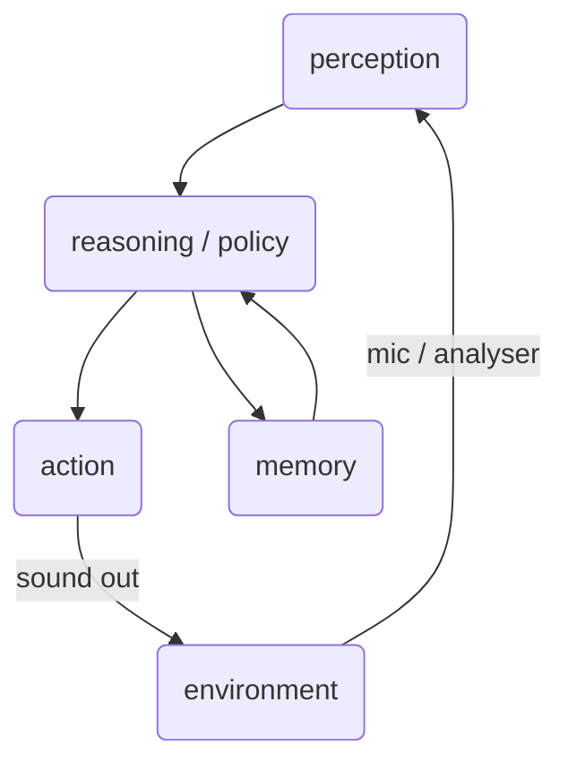

---
tags:
  - class
class: agentic-music
number: "AI-3"
yearupdate: "26"
created: 2026-09-18
modified: 2026-09-18
theme: moon
---


|  |     |                        |
| ---------------------------------------- | :-- | ---------------------: |
| **class AI-3**                           |     | *internet music 26-27* |
|                                          |     |                        |


## from indeterminacy to
# AGENTIC MUSIC
---

<p style="text-align:center;">from <br> algorithmic thinking and indeterminacy (class 01) <br> toward systems that <strong style="color:cyan">perceive</strong>, <strong style="color:yellow">decide</strong> and <strong style="color:magenta">act</strong> on sound</p>

---

### what we can do

---
### how
---

### what we can do



---

## from RGn to agency

---

Class 01 introduced <span style="color:#d763d9">RGn</span> (random number generation) as the first automatable gesture, and <span style="color:#92d050">indeterminacy</span> as a compositional resource. A system that only draws from `Math.random()` has no memory of what it just did and no goal.

---

An <span style="color:#ffff00">agent</span> adds three things a purely random or purely fixed system lacks:

* <span style="color:#03D9DD">perception</span> — it senses something (its own output, a microphone, a score, a dataset, a chat message).
* <span style="color:#92d050">memory / state</span> — it keeps something from one instant to the next.
* <span style="color:#d763d9">policy</span> — a rule, model, or goal that turns what it perceives into what it does.

---

## a working definition

---

**Agentic music** is music produced, performed, or notated by a system that closes a perception–decision–action loop over time, with enough autonomy that its next output is not fully determined by the score, the code, or the performer alone.

---

## a spectrum, not a binary

---

| mode | example | who decides the next event |
| --- | --- | --- |
| fixed | a sequencer with hard-coded notes | the composer, in advance |
| generative | `Math.random()` inside constraints | a distribution, at each tick |
| interactive | a synth mapped to a slider | the performer, in real time |
| **agentic** | a system with perception + memory + policy | **the system, based on its own state** |

---

📕 Eigenfeldt, A. (2017). *Multiagent Musical Composition*, in *Ecological Psychoacoustics* / Trends
📕 Pachet, F. (2003). *The Continuator: Musical Interaction with Style*
📕 Fiebrink, R. & Caramiaux, B. (2016). *The Machine Learning Algorithm as Creative Musical Tool*
📕 Briot, J-P., Hadjeres, G., Pachet, F-D. (2020). *Deep Learning Techniques for Music Generation*

---

## how

html · css · js · Web Audio API · (Tone.js optional, later)

---

# 10 Web Audio API examples

paste each block directly into the browser devtools console — Chrome, Firefox, Safari

---

### 1. context and a first tone

```js
const ctx = new AudioContext();
const osc = ctx.createOscillator();
osc.frequency.value = 440; // A4
osc.connect(ctx.destination);
osc.start();
osc.stop(ctx.currentTime + 1);
```

---

### 2. gain envelope

```js
const ctx2 = new AudioContext();
const osc2 = ctx2.createOscillator();
const gain2 = ctx2.createGain();
gain2.gain.setValueAtTime(0, ctx2.currentTime);
gain2.gain.linearRampToValueAtTime(0.3, ctx2.currentTime + 0.05);
gain2.gain.exponentialRampToValueAtTime(0.001, ctx2.currentTime + 1.2);
osc2.connect(gain2).connect(ctx2.destination);
osc2.start();
osc2.stop(ctx2.currentTime + 1.2);
```

---

### 3. oscillator types

```js
const ctx3 = new AudioContext();
["sine", "square", "sawtooth", "triangle"].forEach((type, i) => {
  const o = ctx3.createOscillator();
  o.type = type;
  o.frequency.value = 220;
  const g = ctx3.createGain();
  g.gain.value = 0.15;
  o.connect(g).connect(ctx3.destination);
  o.start(ctx3.currentTime + i * 0.6);
  o.stop(ctx3.currentTime + i * 0.6 + 0.5);
});
```

---

### 4. a filter sweep

```js
const ctx4 = new AudioContext();
const osc4 = ctx4.createOscillator();
osc4.type = "sawtooth";
osc4.frequency.value = 110;
const filt = ctx4.createBiquadFilter();
filt.type = "lowpass";
filt.frequency.setValueAtTime(100, ctx4.currentTime);
filt.frequency.exponentialRampToValueAtTime(4000, ctx4.currentTime + 2);
osc4.connect(filt).connect(ctx4.destination);
osc4.start();
osc4.stop(ctx4.currentTime + 2);
```

---

### 5. an LFO as tremolo

```js
const ctx5 = new AudioContext();
const carrier = ctx5.createOscillator();
carrier.frequency.value = 300;
const carrierGain = ctx5.createGain();
const lfo = ctx5.createOscillator();
lfo.frequency.value = 6;
const lfoGain = ctx5.createGain();
lfoGain.gain.value = 0.4;
lfo.connect(lfoGain).connect(carrierGain.gain);
carrier.connect(carrierGain).connect(ctx5.destination);
carrierGain.gain.value = 0.4;
lfo.start();
carrier.start();
carrier.stop(ctx5.currentTime + 3);
lfo.stop(ctx5.currentTime + 3);
```

---

### 6. delay with feedback

```js
const ctx6 = new AudioContext();
const osc6 = ctx6.createOscillator();
const delay = ctx6.createDelay();
delay.delayTime.value = 0.25;
const feedback = ctx6.createGain();
feedback.gain.value = 0.5;
osc6.connect(delay);
delay.connect(feedback).connect(delay);
delay.connect(ctx6.destination);
osc6.connect(ctx6.destination);
osc6.start();
osc6.stop(ctx6.currentTime + 0.1);
```

---

### 7. loading and playing an external sound

```js
const ctx7 = new AudioContext();
fetch("https://interactive-examples.mdn.mozilla.net/media/cc0-audio/t-rex-roar.mp3")
  .then(r => r.arrayBuffer())
  .then(buf => ctx7.decodeAudioData(buf))
  .then(decoded => {
    const src = ctx7.createBufferSource();
    src.buffer = decoded;
    src.connect(ctx7.destination);
    src.start();
  });
```

---

### 8. a minimal scheduler (the first "tick")

```js
const ctx8 = new AudioContext();
let step = 0;
const scale = [0, 2, 4, 7, 9]; // pentatonic, semitones
function tick() {
  const o = ctx8.createOscillator();
  const g = ctx8.createGain();
  const midi = 60 + scale[step % scale.length];
  o.frequency.value = 440 * Math.pow(2, (midi - 69) / 12);
  g.gain.value = 0.2;
  o.connect(g).connect(ctx8.destination);
  o.start();
  o.stop(ctx8.currentTime + 0.2);
  step++;
}
const clock = setInterval(tick, 300);
// clearInterval(clock) to stop
```

---

### 9. listening to itself — an analyser loop

```js
const ctx9 = new AudioContext();
const osc9 = ctx9.createOscillator();
const analyser = ctx9.createAnalyser();
analyser.fftSize = 256;
osc9.connect(analyser).connect(ctx9.destination);
osc9.frequency.value = 200;
osc9.start();

const data = new Uint8Array(analyser.frequencyBinCount);
function selfListen() {
  analyser.getByteTimeDomainData(data);
  const amplitude = data.reduce((a, b) => a + Math.abs(b - 128), 0) / data.length;
  osc9.frequency.value = 200 + amplitude * 4; // perceives its own loudness, reacts
  requestAnimationFrame(selfListen);
}
selfListen();
// this is already a one-node agent: it perceives (analyser), decides (the +amplitude*4 rule), acts (frequency)
```

---

### 10. perceiving the room — microphone input

```js
navigator.mediaDevices.getUserMedia({ audio: true }).then(stream => {
  const ctx10 = new AudioContext();
  const mic = ctx10.createMediaStreamSource(stream);
  const analyser10 = ctx10.createAnalyser();
  analyser10.fftSize = 512;
  mic.connect(analyser10);

  const synth = ctx10.createOscillator();
  const synthGain = ctx10.createGain();
  synthGain.gain.value = 0.15;
  synth.connect(synthGain).connect(ctx10.destination);
  synth.start();

  const buf = new Uint8Array(analyser10.frequencyBinCount);
  function agentLoop() {
    analyser10.getByteTimeDomainData(buf);
    const level = buf.reduce((a, b) => a + Math.abs(b - 128), 0) / buf.length;
    synth.frequency.value = 100 + level * 10; // decision: louder room -> higher pitch
    requestAnimationFrame(agentLoop);
  }
  agentLoop();
});
```

---

> [!tip] tOdO
> take example 9 or 10 and replace the decision rule (`200 + amplitude * 4`) with a small state machine: three states (`calm`, `active`, `dense`), each with its own frequency range and oscillator type. that state machine is your first policy.

---

## from example to instrument: the agent pattern

---

```js
const agent = {
  state: { mood: "calm" },

  perceive(input) {
    this.lastInput = input; // mic level, mouse position, an LLM's text, a websocket message...
  },

  decide() {
    // policy: pure rules today; a model, a Markov chain, or an LLM call tomorrow
    if (this.lastInput > 0.6) this.state.mood = "dense";
    else if (this.lastInput > 0.2) this.state.mood = "active";
    else this.state.mood = "calm";
    return this.state.mood;
  },

  act(mood) {
    // trigger sound according to mood
  }
};

function loop(input) {
  agent.perceive(input);
  const mood = agent.decide();
  agent.act(mood);
}
```

---

the same shape (perceive → decide → act, over persistent state) holds whether the decision is three `if` statements or a call to a language model. an LLM used this way is a policy, not a gimmick: it turns text, a corpus, or a set of rules into a decision at each tick. **never call it with an exposed API key from the browser** — route it through a small serverless function (a Vercel function is enough).

---

# setting up the repository

---

1. create a GitHub account if you do not have one, at [github.com](https://github.com)
2. create a new, empty repository (no README, no license) — call it something you will still recognise in June, e.g. `agentic-music-yourname`
3. on your machine:

```bash
git clone https://github.com/yourname/agentic-music-yourname.git
cd agentic-music-yourname
```

4. add an `index.html` (see the first application below), then:

```bash
git add .
git commit -m "first agent"
git push
```

---

work locally with a static server, not `file://`, so `fetch` and modules behave:

```bash
npx serve .
# or, in VS Code: extension "Live Server"
```

---

# deploying on Vercel

---

1. go to [vercel.com](https://vercel.com) and sign in with your GitHub account
2. **Add New → Project**, select your repository
3. no framework, no build command: it is a static site — leave the defaults and press **Deploy**
4. every `git push` to `main` from now on redeploys automatically; a pull request gets its own preview URL

---

or from the terminal, once:

```bash
npm i -g vercel
vercel
```

and `vercel --prod` for the production deploy.

---

# your first agentic music application

---

`index.html`

```html
<!doctype html>
<html>
<head><meta charset="utf-8"><title>agent 01</title></head>
<body>
  <button id="start">start listening</button>
  <script src="agent.js"></script>
</body>
</html>
```

---

`agent.js`

```js
document.getElementById("start").onclick = async () => {
  const ctx = new AudioContext();
  const stream = await navigator.mediaDevices.getUserMedia({ audio: true });
  const mic = ctx.createMediaStreamSource(stream);
  const analyser = ctx.createAnalyser();
  analyser.fftSize = 512;
  mic.connect(analyser);

  const synth = ctx.createOscillator();
  const gain = ctx.createGain();
  gain.gain.value = 0.15;
  synth.connect(gain).connect(ctx.destination);
  synth.start();

  const buf = new Uint8Array(analyser.frequencyBinCount);
  const agent = { mood: "calm" };

  function loop() {
    analyser.getByteTimeDomainData(buf);
    const level = buf.reduce((a, b) => a + Math.abs(b - 128), 0) / buf.length;

    agent.mood = level > 20 ? "dense" : level > 8 ? "active" : "calm";
    const table = { calm: 110, active: 220, dense: 440 };
    synth.frequency.linearRampToValueAtTime(table[agent.mood], ctx.currentTime + 0.05);

    requestAnimationFrame(loop);
  }
  loop();
};
```

---

push this pair of files, deploy, and you have a one-agent instrument reachable from any browser with a URL — the minimal unit this course will keep extending: more inputs (mouse, MIDI, OSC, an LLM's text), richer policies (Markov chains, small models), and eventually several agents listening to one another.

---

## assignment

* deploy the example above on Vercel
* replace one thing: the perception (mic → mouse, scroll, time of day, a `fetch`ed value), the policy (three `if`s → a Markov chain over 4 states), or the action (one oscillator → a small synth voice)
* bring the link, not the code, to the next session
