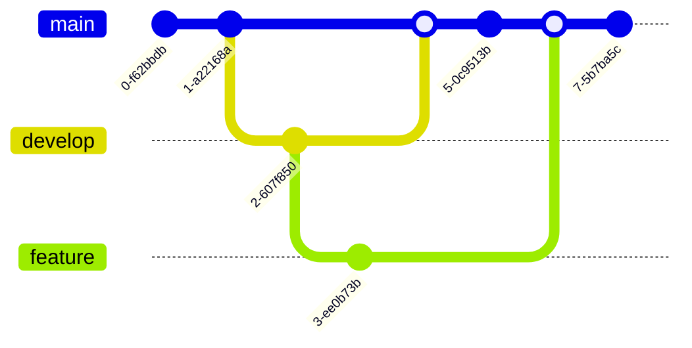

#technologies 



Here’s a step-by-step tutorial in Markdown format for Obsidian on how to use Git as a local version control system, creating and tracking changes to text files.

# Git Local Version Control Tutorial

## 📝 Introduction
This tutorial guides you through **basic Git version control** using a simple workflow with `.txt` files. You will:
1. Create files and track changes.
2. Commit different versions.
3. Use Git to **check, restore, and recover** past versions.


## ✅ **Step 1: Initialize Git**
First, navigate to your project folder in the terminal:
```sh
mkdir git-test && cd git-test
```


Initialize a new Git repository:

```
git init
```

✍️ Step 2: Create and Commit the First Version

Create 1.txt and add initial content:

```
echo "hello version 1" > 1.txt
```
Check the file:

```
cat 1.txt
```
Add the file to Git and commit it:

```
git add 1.txt
git commit -m "Added 1.txt with version 1"
```
✍️ Step 3: Modify the File and Commit Again

Modify 1.txt:

```
echo "hello version 2" > 1.txt
```
Check the change:

```
cat 1.txt
```
Stage and commit:

```
git add 1.txt
git commit -m "Updated 1.txt to version 2"
```
✍️ Step 4: Add a New File

Create another file:

```
echo "hello 2 version 1" > 2.txt
```
Add and commit:

```
git add 2.txt
git commit -m "Added 2.txt with version 1"
```
🔍 Step 5: View Git History

To see commit history:

```
git log --oneline --graph --all
```
To view detailed changes:

```
git log -p
```

♻️ Step 6: Restore an Old Version

To check previous commits:

```
git log --oneline
```

Restore 1.txt from the first commit:

```
git checkout <commit-hash> -- 1.txt
```

Verify:

```
cat 1.txt
```

🚨 Step 7: Undo a Commit

To undo the last commit but keep changes:

```
git reset HEAD~
```

To undo and delete the changes:

```
git reset --hard HEAD~
```

💾 Step 8: Create a Backup Branch

Before making risky changes, create a backup:

```
git branch backup-main
```

Switch back if needed:

```
git checkout backup-main
```

🛑 Step 9: Use Stash for Temporary Backups

If you need to switch branches but have unfinished changes:

```
git stash
```

Restore later:

```
git stash pop
```

🎯 Summary

✔ Track changes: git log --oneline
✔ Recover files: git checkout \<commit-hash> file.txt
✔ Undo commits: git reset HEAD~
✔ Create backup branch: git branch backup-main
✔ Temporary backup: git stash

🚀 Now you can manage and recover versions of files using Git locally!


